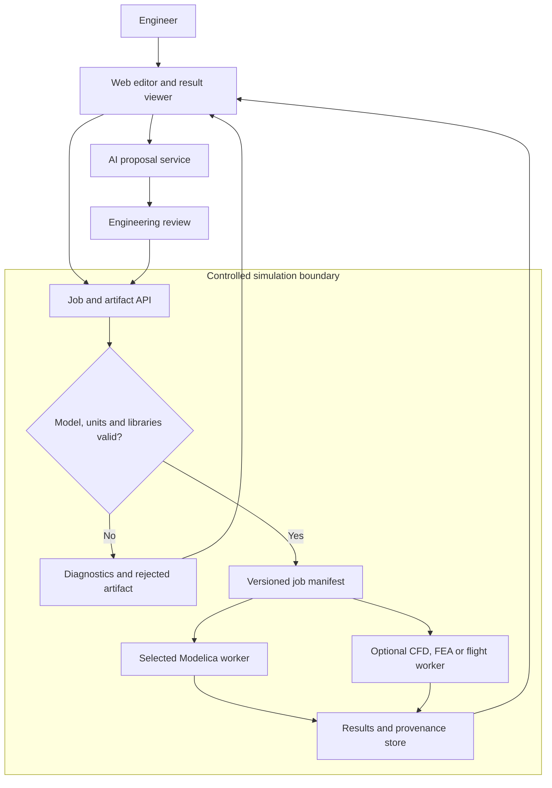
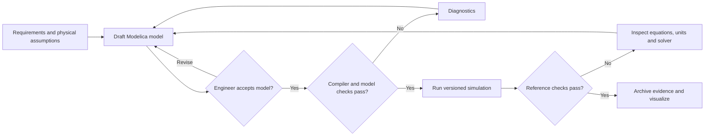
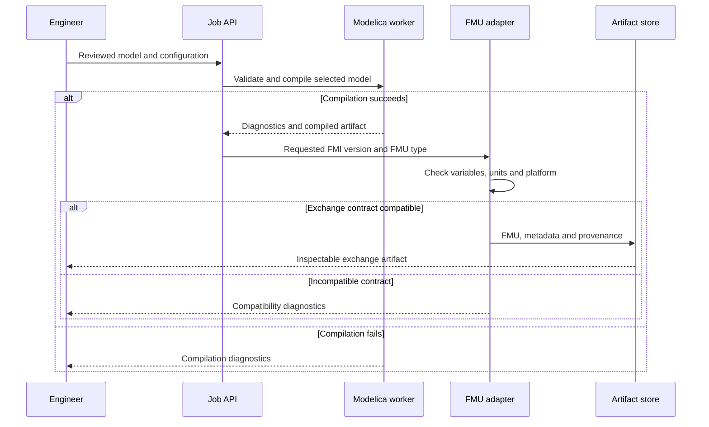
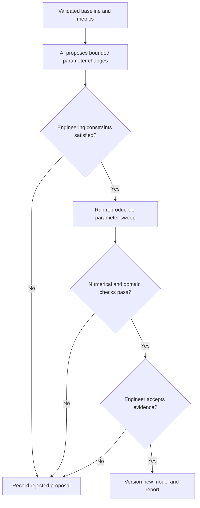

# JFXModelica Cloud AI

JFXModelica is a proposed open-source environment for Modelica-based multiphysics simulation, AI-assisted model authoring and digital-twin workflows. The intended web interface connects engineers to replaceable simulation workers and reviewed model artifacts.

**Current status:** architecture and documentation. The repository contains a README, engineering notes and an existing draw.io asset; it does not yet establish an executable cloud platform, native solver connectors or validated AI-generated Modelica code. The diagrams below describe proposed flows.

## Documentation

- [Documentation index](docs/README.md)
- [Categorized dependency and reference catalog](docs/dependencies/catalog.md)
- [Consolidated MBSE, physical modeling and CAD handbook](docs/engineering/mbse-and-cad-handbook.md)
- [Source register and TXT migration map](docs/source-register.md)
- [Documentation validation](docs/validation.md)
- [Existing technical diagram](MBSE/CAS/Drawio/especificaciones_tecnicas_JFXModelica.drawio.drawio)

## Scope and capabilities

| Area | Proposed capability | Acceptance needed before claiming implementation |
| --- | --- | --- |
| Model authoring | Text or graphical input, Modelica assembly, AI suggestions | Reviewed model source, library versions and compiler diagnostics |
| Physical simulation | Modelica DAE simulation; optional CFD/FEA and flight-dynamics workers | Reproducible fixtures, solver versions, units and numerical comparisons |
| AI assistance | Model proposals, diagnostic explanations and parameter-change suggestions | Source provenance, reviewed equations and independent solver checks |
| Web visualization | Schematics, 3D scenes, result fields and time-series inspection | Versioned geometry/result mapping and measured browser performance |
| Parameter studies | Controlled sweeps, optimization and distributed jobs | Bounded parameters, resource limits, convergence and reproducible evidence |
| FMI interoperability | Import/export and co-simulation through selected FMU tooling | Explicit FMI version, FMU type, platform compatibility and exchange tests |

OpenModelica is a candidate for an initial simulation worker. JModelica and other compilers are alternatives to evaluate, rather than simultaneous mandatory backends. OpenFOAM, CalculiX and JSBSim are optional domain integrations. React/Three.js and replaceable language-model endpoints are frontend/AI candidates, not installed dependencies.

## Proposed architecture

Modelica workers own equation compilation and numerical execution. AI suggestions pass through engineering review and compiler validation. Multiphysics coupling needs defined exchange variables, units, time synchronization and convergence checks; connecting worker names does not establish a working coupled solver.

## Model-to-result workflow

Inputs include model sources, library versions, units, initial conditions, solver configuration and expected behavior. Outputs include diagnostics, numerical results and a run manifest. An equal equation/variable count is only one structural check; it is not proof of physical correctness or numerical solvability.

## FMI and result exchange

FMU exchange is a planned contract boundary. It must distinguish Model Exchange and Co-Simulation, declare its selected FMI version and retain source/model provenance.

## AI-assisted parameter iteration

## Dependency adoption

The [catalog](docs/dependencies/catalog.md) groups the 17 repositories supplied in the additional TXT and the technology candidates already mentioned in this README. Each entry records its role and adoption status. References and forks are not automatically runtime dependencies.

Before adoption, select a commit/release, review its license and provenance, define an interface and execute a bounded compatibility fixture. Package versions, runtime prerequisites and installation commands will belong to an implementation milestone; none are asserted here.

## Next bounded engineering step

Specify one Modelica model and one simulation-worker contract with units, initial conditions, solver configuration, expected numerical behavior and archived results. Use a reviewed deterministic fixture before adding AI generation, distributed execution or additional physics workers.
